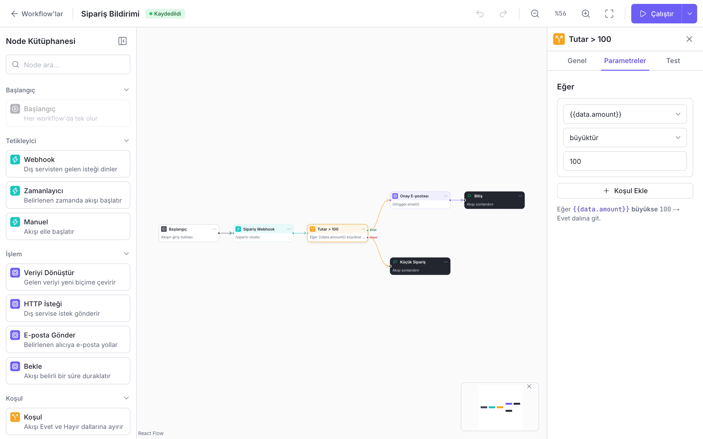
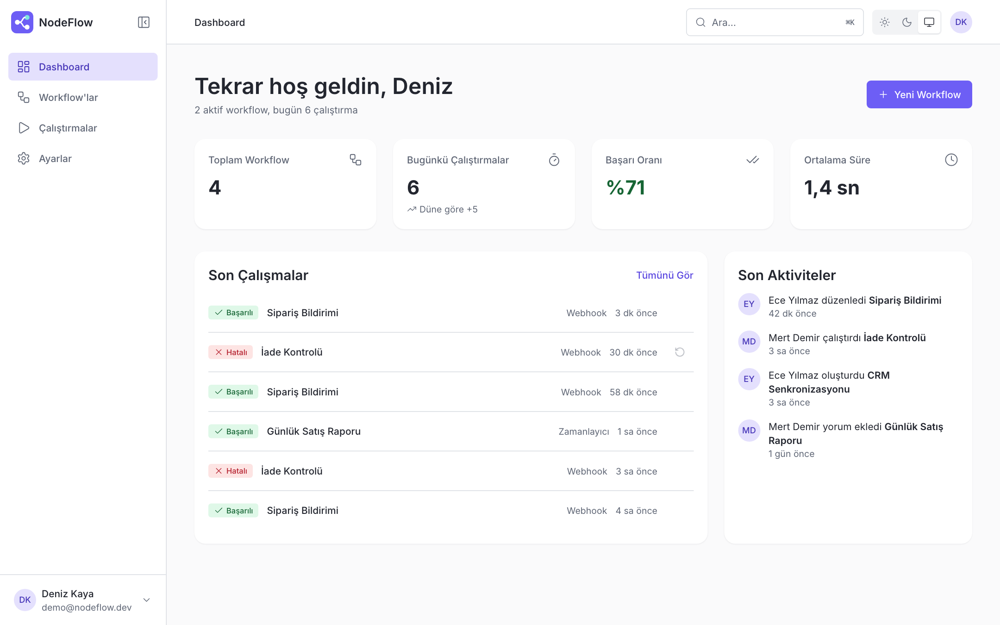
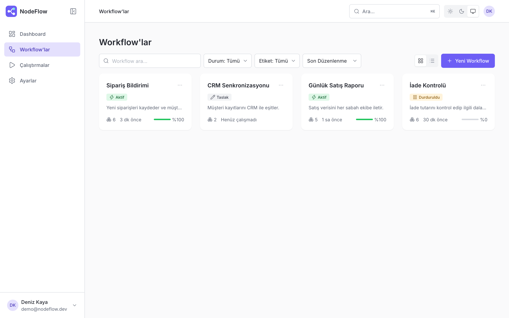
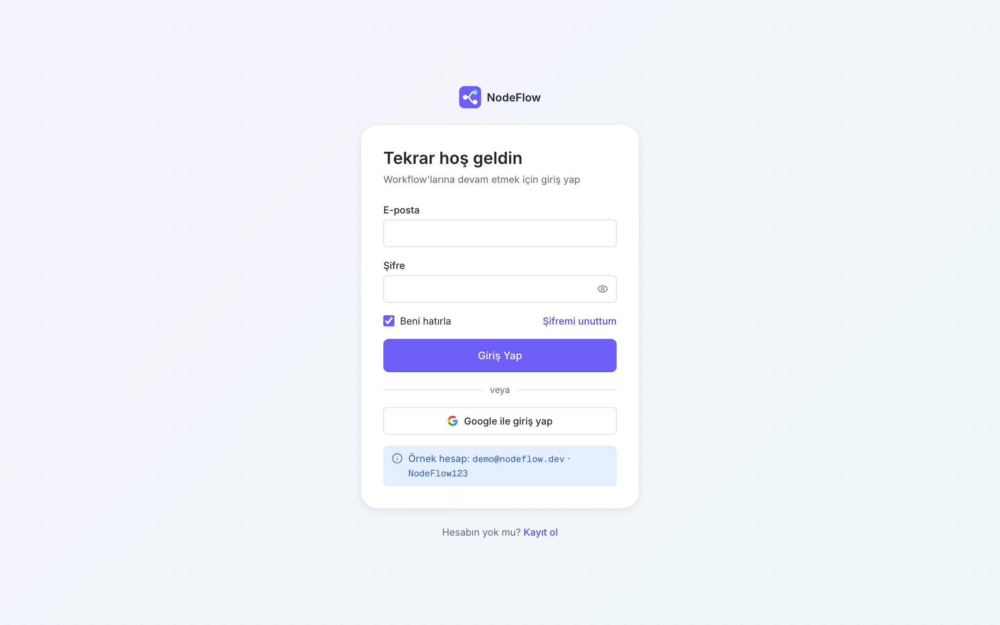
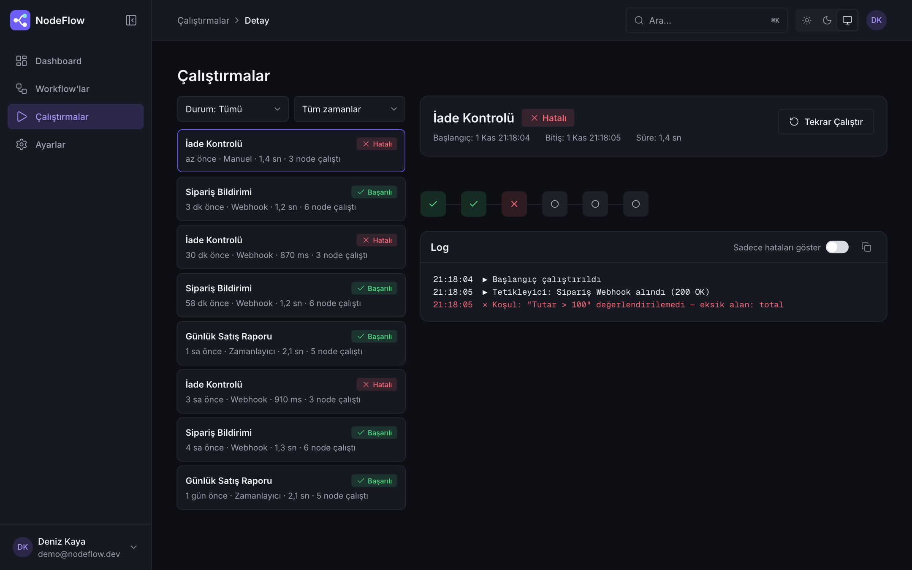
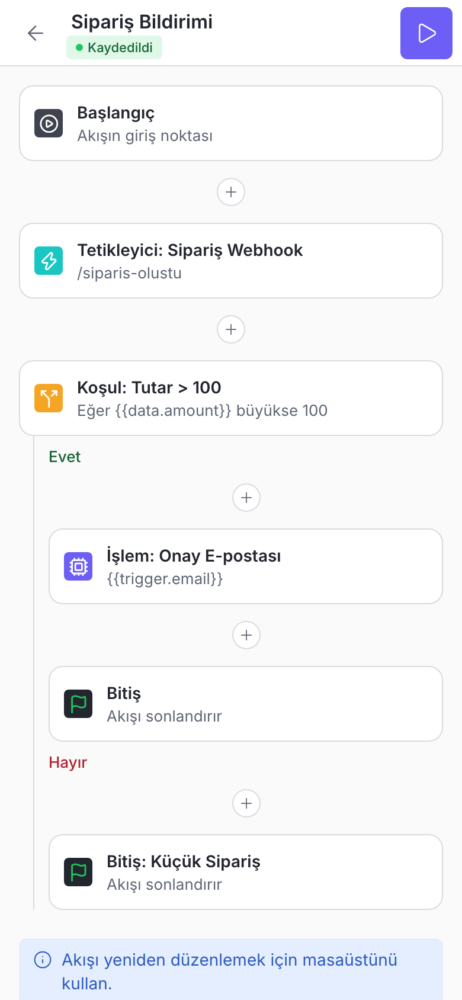

# NodeFlow

Kod yazmadan, sürükle-bırak ile görsel otomasyon akışları kurmayı sağlayan bir platform. Next.js üzerinde feature tabanlı mimari, atomic design ve SOLID ilkeleriyle geliştirildi.

> Veritabanı yerine şimdilik mock API kullanılır. Veriler sunucu belleğinde tutulur ve sunucu yeniden başlayınca örnek verilere döner.



## Özellikler

- **Node Editör:** sürükle-bırak, port'tan port'a bağlantı, geçersiz bağlantı reddi, çoklu seçim, mini harita, geri al/yinele ve otomatik kaydetme
- **Altı node kategorisi:** Başlangıç, Tetikleyici, İşlem, Koşul, Veri ve Bitiş
- **Node ayar paneli:** dinamik parametre formları, Evet/Hayır dallı koşul kurucusu, cron ifadesinin okunur çevirisi, anlık doğrulama ve tek node testi
- **Canlı çalıştırma:** node'lar sırayla renklenir, hatalı node doğrudan test sekmesine götürür
- **Çalıştırma geçmişi:** filtrelenebilir liste, node durum şeridi ve zaman damgalı log paneli
- **Workflow yönetimi:** arama, filtre, sıralama, grid/liste görünümü, toplu işlemler, kopyalama ve JSON dışa aktarma
- **Dashboard:** özet istatistikler, son çalıştırmalar ve aktivite akışı
- **Komut paleti:** `⌘K` ile sayfa, workflow ve aksiyon arama
- **Tema:** açık, koyu ve sistem seçenekleri
- **Responsive:** tablette tek panelli odak modu, mobilde canvas yerine dikey Akış Listesi Modu
- **Erişilebilirlik:** klavye kullanımı, odak halkaları, `prefers-reduced-motion` desteği ve WCAG 2 AA renk kontrastı

## Ekran Görüntüleri

| Dashboard | Workflow'lar |
| --- | --- |
|  |  |

| Giriş | Çalıştırmalar (koyu tema) |
| --- | --- |
|  |  |



## Teknolojiler

Tüm bağımlılıklar açık kaynak ve ücretsizdir.

| Alan | Araç | Görevi |
| --- | --- | --- |
| Çatı | Next.js 16, React 19 | App Router, Route Handler ve sunucu tarafı oturum koruması |
| Dil | TypeScript | Tip güvenliği |
| Stil | Tailwind CSS 4 | CSS değişkenli token'lar ve responsive arayüz |
| Sunucu durumu | TanStack Query | Önbellek, mutation, iyimser güncelleme ve yeniden deneme |
| İstemci durumu | Zustand | Editör, tema, bildirim ve arayüz durumu |
| Formlar | React Hook Form | Form durumu ve performans |
| Doğrulama | Zod | İstemci ve sunucunun paylaştığı sözleşmeler |
| Canvas | React Flow | Node ve bağlantı altyapısı |
| Test | Vitest | Domain ve servis testleri |
| Kod kalitesi | ESLint, Prettier | Katman sınırları ve biçim |
| İkonlar | Lucide | Arayüz ikonları |

## Başlangıç

Node.js 22.12 veya üzeri gerekir.

```bash
npm install
npm run dev
```

Uygulama `http://localhost:3000` adresinde açılır.

**Örnek hesap**

| E-posta | Şifre |
| --- | --- |
| `demo@nodeflow.dev` | `NodeFlow123` |

Örnek hesap hazır workflow ve çalıştırma kayıtlarıyla gelir. Yeni kayıt olan kullanıcı boş çalışma alanıyla başlar.

Mock API yanıt gecikmesi `MOCK_API_DELAY_MS` ortam değişkeniyle ayarlanır (varsayılan: 200 ms).

## Komutlar

| Komut | Açıklama |
| --- | --- |
| `npm run dev` | Geliştirme sunucusunu başlatır |
| `npm run build` | Üretim derlemesi alır |
| `npm run start` | Üretim derlemesini çalıştırır |
| `npm run test` | Birim ve servis testlerini çalıştırır |
| `npm run lint` | ESLint denetimini çalıştırır |
| `npm run typecheck` | TypeScript tip denetimini çalıştırır |
| `npm run format` | Kodu Prettier ile biçimlendirir |

## Mimari

Bağımlılıklar yalnızca yukarıdan aşağıya akar ve bu kural ESLint ile zorunlu kılınır.

```
app  →  widgets  →  features  →  shared
 └────────────→  server  ─────────┘
```

```
src/
├── app/                  rotalar, layout'lar ve API uç noktaları
├── widgets/app-shell/    kenar çubuğu ve üst bar
├── features/
│   ├── auth/             api, hooks, components
│   ├── command-palette/
│   ├── dashboard/
│   ├── editor/           canvas, node kartı, ayar paneli, mobil liste, store
│   ├── executions/
│   ├── settings/
│   ├── theme/
│   └── workflows/
├── server/
│   ├── http/             route sarmalayıcıları ve oturum çerezi
│   ├── services/         iş kuralları
│   ├── repositories/     arayüzler ve bellek içi uygulamalar
│   ├── seed/             örnek çalışma alanı ve şablonlar
│   └── container.ts      bağımlılıkların bağlandığı tek nokta
└── shared/
    ├── api/              HTTP istemcisi ve query ayarları
    ├── contracts/        Zod şemaları
    ├── domain/           node kataloğu, doğrulama, cron, çalıştırma motoru
    ├── stores/           paylaşılan Zustand durumları
    └── ui/               atoms, molecules, templates
```

### Atomic Design

| Seviye | Konum |
| --- | --- |
| Atoms | `shared/ui/atoms` |
| Molecules | `shared/ui/molecules` |
| Organisms | `features/*/components`, `widgets` |
| Templates | `shared/ui/templates` |
| Pages | `app` |

### Durum Yönetimi

Sunucudan gelen veri TanStack Query'de, yalnızca tarayıcıya ait durum Zustand'da tutulur. Editörün geri al geçmişi ve taslakları Zustand'dadır; kaydedilen akış API'ye gider.

### SOLID

- **Tek sorumluluk:** Route Handler yalnızca HTTP'yi, servis iş kuralını, repository veri erişimini yönetir.
- **Açık/Kapalı:** Yeni node, kataloğa eklenerek tanımlanır; çalıştırma davranışı kategori bazlı stratejilerle genişler.
- **Liskov:** `OwnedRepository` uygulamaları birbirinin yerine geçebilir.
- **Arayüz ayrımı:** Kullanıcı, oturum, tercih ve parola işlemleri küçük arayüzlere ayrılmıştır.
- **Bağımlılıkların tersine çevrilmesi:** Servisler arayüzlere, çalıştırma akışı `ExecutionGateway` soyutlamasına bağlıdır.

Gerçek veritabanına geçmek için repository arayüzlerini uygulayıp `server/container.ts` içindeki bağlantıları değiştirmek yeterlidir.

## API

Oturum, `httpOnly` çerezle taşınır. Şifreler `scrypt` ile özetlenir ve her kullanıcı yalnızca kendi verisine erişir.

| Uç nokta | Metot | Açıklama |
| --- | --- | --- |
| `/api/auth/login` | `POST` | Giriş |
| `/api/auth/register` | `POST` | Kayıt |
| `/api/auth/logout` | `POST` | Çıkış |
| `/api/auth/me` | `GET`, `PATCH`, `DELETE` | Profil ve hesap silme |
| `/api/auth/password` | `POST` | Şifre değiştirme |
| `/api/auth/password-reset` | `POST` | Şifre sıfırlama isteği |
| `/api/auth/sessions` | `GET` | Aktif oturumlar |
| `/api/auth/sessions/:id` | `DELETE` | Oturum sonlandırma |
| `/api/workflows` | `GET`, `POST` | Liste ve oluşturma |
| `/api/workflows/:id` | `GET`, `PATCH`, `DELETE` | Detay, güncelleme ve silme |
| `/api/workflows/:id/flow` | `PUT` | Akışı kaydetme |
| `/api/workflows/:id/duplicate` | `POST` | Kopyalama |
| `/api/workflows/bulk-delete` | `POST` | Toplu silme |
| `/api/executions` | `GET`, `POST` | Geçmiş ve çalıştırma başlatma |
| `/api/executions/:id` | `GET`, `PATCH` | Detay ve çalıştırmayı bitirme |
| `/api/activities` | `GET` | Aktivite akışı |
| `/api/preferences` | `GET`, `PATCH` | Bildirim ve güvenlik tercihleri |

## Sayfalar

| Yol | Ekran |
| --- | --- |
| `/giris`, `/kayit`, `/sifre-sifirlama` | Kimlik doğrulama |
| `/panel` | Dashboard |
| `/is-akislari` | Workflow yönetimi |
| `/duzenleyici/[id]` | Node Editör |
| `/calistirmalar`, `/calistirmalar/[id]` | Çalıştırma geçmişi ve detayı |
| `/ayarlar` | Profil, tema, bildirim ve hesap ayarları |

## Klavye Kısayolları

| Kısayol | İşlem |
| --- | --- |
| `⌘/Ctrl + K` | Komut paletini açar |
| `Space + sürükle` | Canvas'ı kaydırır |
| `⌘/Ctrl + kaydırma` | Yakınlaştırır veya uzaklaştırır |
| `Delete` | Seçili node veya bağlantıyı siler |
| `⌘/Ctrl + D` | Seçili node'ları kopyalar |
| `⌘/Ctrl + Z` | Geri alır |
| `⌘/Ctrl + Shift + Z` | Yineler |
| `⌘/Ctrl + S` | Hemen kaydeder |

## Sınırlar

- Veriler bellektedir; sunucu yeniden başlayınca kayıtlar ve oturumlar sıfırlanır. Sunucusuz ortamlarda örnekler arasında veri paylaşılmaz.
- Webhook, zamanlayıcı, e-posta ve HTTP işlemleri gerçekten çalışmaz; çalıştırmalar örnek girdiyle simüle edilir.
- Google ile giriş, fotoğraf yükleme ve şifre sıfırlama e-postası örnek olarak yer alır.
